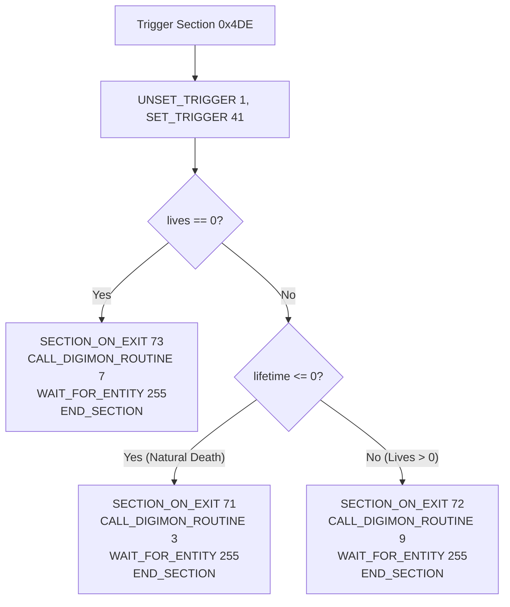

# Death, Lives, and Reincarnation Spec

Specification for porting the partner lives system, death, hospital recovery, death digivolution, and reincarnation (`CALL_DIGIMON_ROUTINE` 3, 4, 7, 9, 10; script builtins 29 and 47; MAPHEAD section `0x4DE`, and DG script 212 sections 71, 72, 73).

Source references:
- `src/murd/murd.c` (796 lines: lives box, heart loss animation, iris transition, map warp)
- `src/dooa/dooa.c` (1760 lines: digital shard dissolution, rebirth cutscene, baby hatching, stat inheritance)
- `src/doo2/doo2.c` (800 lines: egg selection box UI, egg icons, shard sets)
- `src/main/evolution.c` (`reincarnatePartner`:1054)
- `src/main/partner_impl.c` (`initializeReincarnatedPartner`:758, `setReincarnateStats`:810)
- `src/main/script_common.c` (`lostAllLives`:2456, builtin 47)
- `src/main/script_interp.c` (routine dispatch, builtins 29 and 47)
- `src/main/tamer.c` (`tamerTickSicknessLostLife`:1699, `tamerTickBattleLostLife`:1734, `addTamerLevel`:1309)
- `asset_porter/output/scripts/MAPHEAD/script.json` (section `0x4DE`)
- `asset_porter/output/scripts/DG/script_212.json` (sections 71, 72, 73)

---

## 1. Overview & Life Loss Triggers

The partner Digimon has a life counter (`PARTNER_PARA.lives`, starting at 3 hearts). A life is lost under two circumstances:
1. **Battle Loss:** Partner HP drops to 0 in battle. `handleItemLoss` runs, partner loses 1 life (`lives = max(0, lives - 1)`). If `lives == 0`, `remainingLifetime = 0`.
2. **Prolonged Sickness:** Partner remains sick for 12 cumulative hours (`sickness_timer >= 12 * 60`). The sickness timer resets to 0, and partner loses 1 life. If `lives == 0`, `remainingLifetime = 0`.

A third condition triggers **Natural Death (Old Age)**:
3. **Lifetime Expiration:** `remainingLifetime <= 0` while outside the immortal hour. Flags `IS_NATURAL_DEATH = true`.

All three conditions trigger script section `0x4DE` of `MAPHEAD.SCN`.

---

## 2. MAPHEAD Section `0x4DE` (The Dispatcher)

Section `0x4DE` coordinates the transition between the active field/battle context and the death/recovery scenes:



- **`CALL_DIGIMON_ROUTINE 7` (0 Lives Left, Death):** Sets tamer state 17 (`tamerTickSicknessLostLife`) and partner state 12. Executes `MURD` scene displaying 0 hearts, then transitions into `DOOA` dissolution.
- **`CALL_DIGIMON_ROUTINE 3` (Natural Death):** Sets partner state 8 (`partnerTickDying`). Unsets camera follow, loads `DOOA`, and begins particle dissolution immediately.
- **`CALL_DIGIMON_ROUTINE 9` (Lives Remaining > 0):** Sets tamer state 19 (`tamerTickBattleLostLife`) and partner state 12. Executes `MURD` scene displaying remaining hearts and animating the lost heart.

---

## 3. The `MURD` Scene (Lives Box & Iris Transition)

`MURD` (`src/murd/murd.c`) renders the life loss cutscene:

### 3.1 Visual Assets & Layout
- Texture: `ETCHI/LIFE.TIM` (palette 0, CLUT at (128, 488)):
  - Backdrop banner (`MURD_LIVES_BACKDROP`): 64 × 24 px at (-85, -40).
  - Full heart (`MURD_LIFE_FULL`): 24 × 24 px at (-11 + heart_index * 26, -40).
  - Empty heart (`MURD_LIFE_EMPTY`): 24 × 24 px at (-11 + heart_index * 26, -40).
- Box animation:
  - Starts collapsed at (-8, -6, 16, 12), animates out to (-95, -50, 190, 44) over 12 frames.

### 3.2 Sequence Timeline
1. **Iris In:** Black circular iris closes centered on the partner Digimon over 35 frames (`0x23`).
2. **Lives Display:** Background map disables. Three hearts appear showing the previous life count. The lost heart flashes and switches to the empty heart sprite.
3. **Screen Flash & Fade:** White screen flash rises (`lerp(0, 0xA0)`), holds, and fades to black.
4. **Warp to Recovery Map:**
   - Evaluates destination:
     - If `prosperity >= 50` OR Trigger `0xDC` (Centarumon clinic) OR Trigger `0xD6`: destination is `ROOM10` (map `0xCD`, Centarumon's clinic / File City Clinic).
     - Otherwise: destination is `ROOM08` (map `0xDA`, File City house / bed).
   - On warp, executes the registered `SECTION_ON_EXIT` script (Section 72 or 73 of Script 212).

---

## 4. Death Digivolution (Script 212 Section 72)

When waking up in the clinic after losing a battle with lives remaining, Script 212 Section 72 executes. At offset 2020, the game rolls a random number 0–99 (`STORE_RANDOM 99, PSTAT 110`) to check for death digivolution:

| Partner Digimon Stage / Species | Trigger Condition | Roll (0–99) | Evolves Into | Digimon ID |
| :--- | :--- | :--- | :--- | :--- |
| **Rookies** (Agumon, Betamon, Gabumon, Elecmon, Patamon, Kunemon, Biyomon, Palmon) | None | `< 10` (10%) | **Bakemon** | 37 |
| **MetalGreymon** (12) / **Megadramon** (54) | None | `< 10` (10%) | **SkullGreymon** | 26 |
| **Kokatorimon** (50) | None | `< 10` (10%) | **Phoenixmon** | 59 |
| **Angemon** (20) | Discipline $\le$ 49 | `< 50` (50%) | **Devimon** | 6 |

### Digivolution Execution
1. If roll succeeds:
   - Sets `PSTAT 254` to target Digimon ID.
   - Calls `CALL_DIGIMON_ROUTINE 10` (`EVOLUTION_TARGET = readPStat(254); partnerSetState(13)`).
   - Delays 550 frames while the evolution cutscene plays.
   - Displays textbox: `"{partner_name} has digivolved!"`.
2. If roll fails or Digimon is ineligible:
   - Digimon remains unchanged.
   - Fully restores HP and MP (`ADD_STAT 6, 9999; ADD_STAT 7, 9999`).
   - Clears injury / sickness conditions (`REMOVE_CONDITION 32; REMOVE_CONDITION 64`).
   - Jijimon or Centarumon comments on their recovery.

---

## 5. The Death & Dissolution Scene (`DOOA`)

When `lives == 0` or upon natural death (`lifetime <= 0`), the partner dissolves into digital particles (`src/dooa/dooa.c`):

1. **Dissolution (`DOOA_tickDissolve`):**
   - Partner Digimon model freezes or plays dying animation (`0x2C` or idle).
   - 3D triangle and quad shards break away from the model's bones, spinning and floating outwards.
   - Screen irises/fades to black.
   - Destination set to Jijimon's house interior (`TWNA01` / `0xCC`).
2. **Script 212 Section 71 (Natural Death) vs Section 73 (0 Lives):**
   - **Section 71:** Jijimon explains that the partner passed away peacefully and gave birth to a Digitama. Calls **Builtin 29** (`DOO2_tickEggInput`) allowing player to pick an egg.
   - **Section 73:** Jijimon explains that partner lost all life. Tamer Level reduced by 1. Calls **Builtin 47** (`lostAllLives`) to forget moves. Egg is assigned randomly (`rand() % 4`).

---

## 6. Builtin 29 (Egg Selection) & Builtin 47 (Lost All Lives)

### 6.1 Builtin 29: Egg Selection UI (`DOO2_tickEggInput`)
- Opens UI Box 3 (`MAIN_D_80134B90`, 168 × 80 px).
- Displays 4 eggs (`ETCDAT/TAMA.TIM`):
  - Index 0: **Botamon** (baby ID 1)
  - Index 1: **Poyomon** (baby ID 15)
  - Index 2: **Punimon** (baby ID 29)
  - Index 3: **Yuramon** (baby ID 43)
- Controls:
  - Left / Right (D-pad): changes `eggSlot = (eggSlot +/- 1) % 4`, plays sound (0, 2).
  - Cross (✕): confirms egg selection, plays sound (0, 3), closes box.

### 6.2 Builtin 47: Move Loss (`lostAllLives`)
When dying with 0 lives, trauma causes the player/partner to forget learned techniques:
- Percentage forgotten: $P = (10 - \text{tamerLevel}) \times 2\%$.
- Number of moves forgotten: $N = \text{round}(P \times \text{totalLearnedMoves} / 100)$.
- For each forgotten move:
  - Picks a random move from the learned pool.
  - Calls `unlearnMove(moveId)`.
  - Displays MAPHEAD textbox section `0x4D8`: `"{move} has been forgotten!"`.

---

## 7. Rebirth & Stat Inheritance (`CALL_DIGIMON_ROUTINE 4`)

`reincarnatePartner` (`src/main/evolution.c:1054`) and `initializeReincarnatedPartner` (`src/main/partner_impl.c:758`):

### 7.1 Fresh Digimon Base Stats
| Egg / Baby | HP | MP | Offense | Defense | Speed | Brains |
| :--- | :--- | :--- | :--- | :--- | :--- | :--- |
| **Botamon** (1) | 90 | 110 | 10 | 11 | 9 | 10 |
| **Poyomon** (15) | 120 | 100 | 16 | 8 | 8 | 6 |
| **Punimon** (29) | 100 | 140 | 12 | 6 | 6 | 8 |
| **Yuramon** (43) | 100 | 120 | 8 | 8 | 8 | 8 |

### 7.2 Stat Inheritance Formula
$$\text{inheritedStat} = \begin{cases} \lfloor \text{DEATH\_STATS.stat} \times \frac{\text{tamerLevel}}{100} \rfloor & \text{if } \text{IS\_NATURAL\_DEATH} = 1 \\ 0 & \text{if } \text{IS\_NATURAL\_DEATH} = 0 \text{ (0 lives)} \end{cases}$$
- If Tamer Level is 10 and natural death occurs, 10% of the previous partner's stats are inherited.
- If death was from 0 lives, 0% stats are inherited.

### 7.3 Reset Parameters
- `lives`: set to 3.
- `remainingLifetime`: 360 hours (15 days).
- `age`: 0.
- `weight`: `defaultWeight` of baby Digimon.
- `happiness`: 50, `discipline`: 50.
- `careMistakes`: 0, `battles`: 0.
- `sicknessTimer`: 0, `injuryTimer`: 0.
- `moves`: equipped move set to `0x2E` (Bubble), remaining 3 slots cleared (`0xFF`).
- `tamer.raisedCount`: incremented by 1 (max 99).
- Partner marked as raised (`setDigimonRaised(babyId)`).
- Jijimon asks if the tamer wants to rename the partner (`CALL_ROUTINE 0x20`).

---

## 8. Godot Architecture & Composition Design

In alignment with Godot's design philosophy and our decoupled architecture (`specs/scenes.md`, `specs/content.md`):

```
scenes/field/hosts/
└── death_host.tscn          <-- Dedicated host node for life loss & reincarnation
scripts/field/hosts/
└── death_host.gd            <-- Manages MURD, DOOA, egg selection, and warp routing
scripts/ui/
├── murd_box.gd              <-- 3-heart lives box UI and heart loss animations
└── egg_select_box.gd        <-- Builtin 29 4-egg selector dialog
scripts/script/
└── death_routines.gd        <-- Builtins 29, 47, and Digimon routines 3, 4, 7, 9, 10
```

- **`DeathHost`**:
  - Sits under `Field/Systems/DeathHost`.
  - Connects to `CareHost.life_lost`, `CareHost.natural_death`, and `BattleHost.battle_lost`.
  - Handles the visual iris close, screen flashes, and camera control during death sequences.
- **`MurdBox`**:
  - Independent UI control that renders `ETCHI/LIFE` textured quads with `PsxUiFilter`.
  - Uses `POLY_G4` / `PsxDraw` for authentic PSX aesthetics.
- **`EggSelectBox`**:
  - Reusable modal box for builtin 29, emitting `egg_selected(slot)`.
- **`DeathRoutines`**:
  - Plugs directly into `ScriptInterpreter.routines` and `ScriptContext`.
  - Enables section `0x4DE` and Script 212 to execute natively through the bytecode VM.

---

## 9. Verification & Automated Tests

A dedicated test suite `tests/test_death_reincarnation.gd` will verify:
1. **Section `0x4DE` Routing:**
   - With `lives > 0` and `lifetime > 0` $\rightarrow$ calls routine 9, sets `SECTION_ON_EXIT 72`.
   - With `lives == 0` $\rightarrow$ calls routine 7, sets `SECTION_ON_EXIT 73`.
   - With `lifetime <= 0` $\rightarrow$ calls routine 3, sets `SECTION_ON_EXIT 71`.
2. **Death Digivolutions (Section 72):**
   - Agumon with roll 5 evolves to Bakemon (37).
   - Agumon with roll 15 stays Agumon.
   - MetalGreymon with roll 8 evolves to SkullGreymon (26).
   - Kokatorimon with roll 7 evolves to Phoenixmon (59).
   - Angemon with discipline 40 and roll 30 evolves to Devimon (6).
   - Angemon with discipline 60 does not evolve.
3. **Move Forgetting (Builtin 47):**
   - Calculates correct forgotten count according to formula $(10 - \text{level}) \times 2\%$.
   - Unlearns chosen moves and preserves remaining moves.
4. **Egg Selection & Stat Inheritance:**
   - Base stats assigned for all 4 baby Digimon.
   - Stat inheritance applies strictly when `IS_NATURAL_DEATH == 1` based on `tamerLevel`.
   - 0% stat inheritance when `IS_NATURAL_DEATH == 0`.
   - Lives reset to 3, lifetime reset to 360, age to 0, moves to Bubble.
